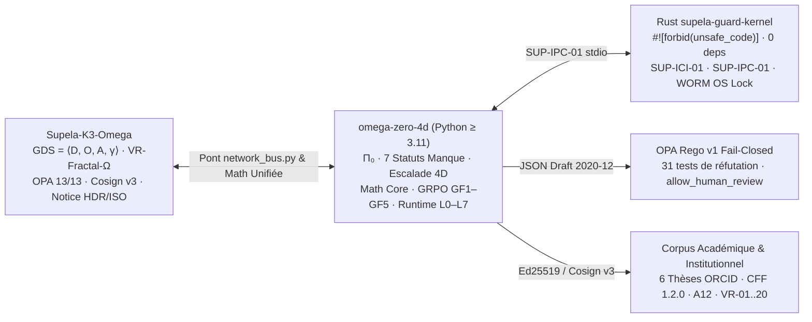

# Supela Ω-ZERO · Local–Cloud–4D

[](https://github.com/gadboisjean1000-arch/omega-zero-4d/actions/workflows/omega-zero-ci.yml)
[](https://github.com/gadboisjean1000-arch/omega-zero-4d/actions/workflows/vr-governance-triage.yml)
[](LICENSE)
[](https://orcid.org/0009-0001-5361-6795)
[%20%7C%200%20deps-orange.svg)](rust/supela-guard-kernel/README.md)
[](policies/omega_zero_invariants.rego)

> **Executive Summary (EN) :** *Supela Ω-ZERO · Local–Cloud–4D* is an executable, fail-closed formal governance and verification engine combining Python 3.11+, a zero-dependency `#![forbid(unsafe_code)]` Rust Guard-Kernel (`SUP-ICI-01` / `SUPELA-WORM-V1`), OPA Rego v1 refutation policies, JSON Schema Draft 2020-12 contracts, Ed25519 / Cosign v3 attestations, unified formal mathematics (`MAT-00..MAT-08`, `VR-Fractal-Ω`, `GENERIC n-D`), and a 6-thesis scholarly deposit framework linked to [ORCID 0009-0001-5361-6795](https://orcid.org/0009-0001-5361-6795). Companion monolith: [Supela-K3-Omega](https://github.com/gadboisjean1000-arch/Supela-K3-Omega).
>
> **Principe Graal :** *On sait qu'on ne sait pas.* Ce dépôt **ne proclame pas** sa validité ; il la **mesure**, la **réfute** et distingue explicitement le **prouvé mécaniquement** du **déclaratif**.

---

## Architecture Unifiée de l'Écosystème Supela



## Repères Institutionnels, Scientifiques & Sécurité

| Document | Rôle |
|---|---|
| [`GEMINI.md`](GEMINI.md) | Constitution opérationnelle, cartographie des instances & 24 outils MCP |
| [`docs/constitution/FORMALISATION_MATHEMATIQUE_UNIFIEE.md`](docs/constitution/FORMALISATION_MATHEMATIQUE_UNIFIEE.md) | Monographie mathématique unifiée (`MAT-00..MAT-08`, `VR-Fractal-Ω`, `GENERIC n-D` $M \succeq 0$, `SGG_v2`, `TZI`, `GRPO`) |
| [`docs/constitution/MATRICE_CONFORMITE_INSTITUTIONNELLE.md`](docs/constitution/MATRICE_CONFORMITE_INSTITUTIONNELLE.md) | Matrice Défense / Gouvernement / ISO / NIST SSDF / SLSA / Université (prouvé vs déclaratif) |
| [`docs/constitution/CADRE_DIRECTEUR_OSBL_VALORISATION.md`](docs/constitution/CADRE_DIRECTEUR_OSBL_VALORISATION.md) | Cadre directeur OSBL (Québec Partie III), gouvernance économique, TCB minimal & contrat-cadre *Strictum Jus* |
| [`CITATION.cff`](CITATION.cff) & [`reports/theses_orcid_0009/`](reports/theses_orcid_0009/deposit_manifest.json) | Citation normalisée CFF 1.2.0, BibTeX, ORCID Work v3.0 et 6 thèses autonomes signées Ed25519 |
| [`SECURITY.md`](SECURITY.md) & [`LICENSE`](LICENSE) | Politique de divulgation coordonnée (RFC 9116 / SSDF), modèle de menaces & licence `Apache-2.0` |
| [`docs/constitution/INDEX_CONSTITUTION.md`](docs/constitution/INDEX_CONSTITUTION.md) | Bijection intégrale anti-orphelins (Règle A12) |

---

## Périmètre Technique & Couches de Vérification

Implémentation exécutable, schémas JSON Draft 2020-12, politiques OPA Rego v1 et suite de réfutation pour :
- l'opérateur de projection $\Pi_0(S_t) = \{I, P, M, A, H\}$ ;
- la machine à états des 7 statuts du Manque et règles M1–M5 ;
- le protocole d'escalade 4D `PLAN-4D-ΩZERO-ESC-01` (`E0..E7`, `C01..C10`, `Load(C)`, revidage transactionnel) ;
- le second exemple inter-domaines (Hydrologie × Droit administratif × Secours × Éthique territoriale) ;
- le pont méthodologique Supela-GRPO (`Exploration ≠ Autorité`, `Score ≠ Preuve ≠ Vérité`) ;
- le noyau mathématique unifié ([`src/omega_zero/supela_math_core.py`](src/omega_zero/supela_math_core.py)) : treillis probatoire $G_0..G_4$, agrégation multi-échelles `VR-Fractal-Ω` par moyenne harmonique pondérée, mécanique irréversible `GENERIC` $n$-D avec semi-définie positivité $M \succeq 0$ (Cholesky pivoté), simplexe rationnel exact `SGG_v2`, contraction métrique `TZI`, garde `VR-22` et preuve analytique + différences finies GRPO ;
- les couches complémentaires de vérification :
  - `WormVault` ([src/omega_zero/worm_ledger.py](src/omega_zero/worm_ledger.py) et [runtime/init_omega_vault.ps1](runtime/init_omega_vault.ps1)) : WORM **logique** (manifeste lecture seule `0o444` / `IsReadOnly` + ledger append-only chaîné SHA-256 ; ne prétend pas à un WORM matériel ni TPM/TEE) ;
  - `supela-guard-kernel` ([rust/supela-guard-kernel/README.md](rust/supela-guard-kernel/README.md)) : noyau Rust `#![forbid(unsafe_code)]`, 0 dépendance tierce, journal OS-verrouillé `SUPELA-WORM-V1` ;
  - `AttestationSigner` Ed25519 ([src/omega_zero/attestation.py](src/omega_zero/attestation.py)) + signature par `cosign v3` (`--bundle`) ;
  - vérificateur Règle A12 anti-orphelins & cohérence croisée JSON/Rego/Markdown ([scripts/verify_a12.py](scripts/verify_a12.py)) ;
  - tests de propriétés `Hypothesis` et invariance exhaustive sur les `4! = 24` permutations (`E3`).

## Exécution rapide

```bash
python -m pip install -e ".[dev]"
make all
```

Ou étape par étape :

```bash
ruff check src/ tests/ scripts/
mypy src/ scripts/verify_a12.py scripts/build_encyclopedie.py scripts/vr_compliance_check.py
python scripts/verify_a12.py
python scripts/vr_compliance_check.py
python docs/constitution/HARNAIS_TEST_ESCALADE_4D.py
pytest -v
opa fmt --diff policies/ tests/rego/
opa check --strict policies/ tests/rego/
opa test policies/ tests/rego/ -v --explain=fails
```

Noyau Rust durci :

```bash
cd rust/supela-guard-kernel
cargo fmt -- --check
cargo clippy --all-targets --all-features -- -D warnings
cargo test --locked --all-targets
```

Sous Windows :

```powershell
.\omega.ps1 -Task All
```

> **Transparence :** `make attest` (ou `.\omega.ps1 -Task Attest`) échoue explicitement si `tpm2_quote` est absent : aucun ancrage silicium TPM/TEE n'est simulé.
