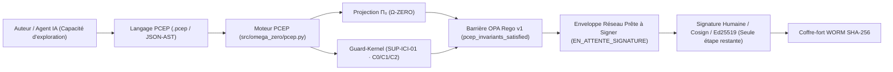

# Formalisation Réseau PCEP · Programmation Évolutive à Preuve Conservée

> **Statut épistémique :** Spécification formelle exécutable intégrée au réseau `omega-zero-4d` · **Enveloppe prête à signer (`EN_ATTENTE_SIGNATURE`)**.
> **Principe directeur :** Une conclusion, une transformation de code ou un agent IA ne doit jamais disposer d'une autorité supérieure à la preuve vérifiée qui la soutient.

---

## 1. Équation Fondamentale de Transformation

Dans le paradigme **Proof-Carrying Evolutionary Programming (PCEP)**, une évolution logicielle ou cognitive ne remplace pas silencieusement l'état précédent :

$$\text{Code}_{t+1} = \text{Transformation}(\text{Code}_t) + \text{Trace} + \text{Portée} + \text{Preuve} + \text{Contre-preuve}$$

Chaque étape d'évolution transporte explicitement :
1. **L'origine et la filiation** (`previous_hash` → `next_hash`, zéro effacement) ;
2. **La trace de transformation** (`Trace`) ;
3. **La portée explicite** (`Portée` / `scope`) et le **référentiel** (`R`) ;
4. **Les preuves vérifiées** (`Preuve` / `proof_refs`) ;
5. **Les contre-preuves et contradictions conservées** (`Contre-preuve` / `counter_evidence`).

---

## 2. Les 9 Familles de Codage Formalisées sur le Réseau

| # | Famille | Opérateur / Machine d'états | Invariant Fail-Closed |
|---|---|---|---|
| **F1** | **Code auto-révocable** | `VALID → CONTRADICTED → REOPEN → REVALIDATE` | Saut direct `CONTRADICTED → VALID` interdit. |
| **F2** | **Provenance native** | Chaîne `origin`, `author`, `previous_hash`, `transformation` | Aucun état orphelin sans filiation SHA-256. |
| **F3** | **Code temporel intergénérationnel** | `Generation_N → Generation_N+1` via `SupelaGuardKernel` (`G0..G5`, `C0`/`C1`/`C2`) | `SUP-ICI-01` : $K_n \subseteq \operatorname{Accessible}(G_{n+1})$ ; `C2` (`reversible = false`) honnête. |
| **F4** | **Programmation multi-référentiels** | `TRUE(R1)`, `UNKNOWN(R2)`, `CONTRADICTORY(R3)` + `Transport(R1 → R2)` | `TRUE(R1)` ne devient jamais `TRUE(R2)` sans `transport_proof_verified == true`. |
| **F5** | **Code à contradictions conservées** | Registre monotone `counter_evidence` (`effacement_interdit = true`) | Une contradiction révoque l'autorité sans effacer l'historique. |
| **F6** | **Calcul par cônes de dépendance** | Graphe orienté `Claim → Dependents` | Seul le cône impacté est réévalué de manière incrémentale. |
| **F7** | **Agents IA à autorité calculée** | `action_authority <= verified_proof_level` | `capacité de raisonnement ≠ autorité d'action`. |
| **F8** | **Systèmes auto-réfutables** | `SelfRefutingProbe` (`PASS` / `FAIL_INFORMATIF`) | Un `FAIL` adversarial est conservé comme contre-preuve utile. |
| **F9** | **Encyclopédies exécutables** | `Claim(Sources, Proofs, CounterEvidence, Dependencies, Referential, Status, History)` | Relations vérifiables par calcul et validées par schéma Draft 2020-12. |

---

## 3. Architecture Concrète du Réseau



---

## 4. Exemple de Langage Minimal (`.pcep` / JSON-AST)

```pcep
referential R_LOCAL  { scope: "python-runtime-3.11", axioms: ["determinism", "utf8"] }
referential R_GLOBAL { scope: "universal-all-systems", axioms: ["unbounded"] }

claim C_PI0_IDEMPOTENT {
  referential: R_LOCAL,
  sources: ["src/omega_zero/projection.py"],
  proofs: ["pytest:test_pi0_and_manque", "hypothesis:24_permutations"],
  counter_evidence: [],
  dependencies: ["M-001"],
  status: "VALID"
}

transport C_PI0_IDEMPOTENT from R_LOCAL to R_GLOBAL {
  transport_proof_verified: false,
  reason: "Preuve locale ≠ validité universelle"
} // Résultat réseau: UNKNOWN(R_GLOBAL), transport_allowed = false

evolve Code_t -> Code_t_plus_1 {
  transformation: "add_pcep_envelope",
  trace: "sha256:...",
  scope: "R_LOCAL",
  proofs: ["pytest", "opa_eval", "a12"],
  counter_evidence: ["open_proofs_registry:A_PROUVER"]
}
```

---

## 5. Registre Honnête des Points Non Prouvés (`A_PROUVER`)

Conformément à la discipline Supela (*une pierre marquée « à prouver » vaut davantage qu'une pierre déclarée vraie trop tôt*), les points suivants sont explicitement conservés dans `open_proofs_registry` avec `status = "A_PROUVER"` et `promoted = false` :

- `OPEN-01`: Validité universelle de Supela sur tout système arbitraire.
- `OPEN-02`: Théorème du Vide / stabilisation absolue vers $\Omega_0$ comme théorème général.
- `OPEN-03`: Terminaison générale d'un calcul Supela arbitraire.
- `OPEN-04`: Transport général du `VRAI` entre référentiels $R_1 \to R_2$ sans perte de validité.
- `OPEN-05`: Compression intergénérationnelle sans perte de sens pour toute classe d'objets.
- `OPEN-06`: Exhaustivité du cône de dépendance et de la provenance hors journal.
- `OPEN-07`: Gold Signature et certification institutionnelle externe universelle.
- `OPEN-08`: Doctrine `0$ PMU` universelle et souveraineté matérielle complète.

---

## 6. Enveloppe Réseau Prête à Signer (`EN_ATTENTE_SIGNATURE`)

Le bus réseau (`omega-network pcep-prepare` et l'outil MCP `omega_pcep_prepare`) génère une enveloppe canonique complète :
- Validée par `schemas/supela_pcep_network_1.schema.json` (Draft 2020-12) ;
- Vérifiée par `policies/omega_zero_invariants.rego` (`pcep_invariants_satisfied`) ;
- Scellée par empreinte canonique `canonical_payload_sha256` ;
- Avec `signature_status = "EN_ATTENTE_SIGNATURE"` et `signature = null` : **seule la signature humaine/autorité reste à apposer**.
